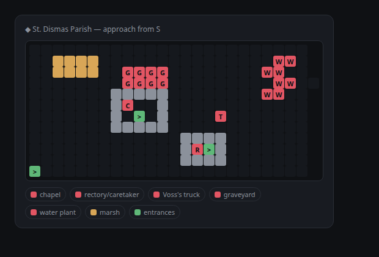

# DND.exe

A text-adventure plugin for [Paseo](https://paseo.sh). Type `/dnd` in any agent
session's composer and it rolls up a dedicated adventure: a fresh agent whose
real system prompt is a Dungeon Master, running on whatever provider/model the
session it spawned from was using.

```
/dnd                              classic heroic fantasy
/dnd gothic vampire soap opera    any theme you can type
/dnd @devin/swe-2-high neon heist pick a different brain first
```



## The pitch

Asking a model to "run a text adventure" works — for a while. Then it forgets
your inventory, fudges every dice roll into whatever's dramatic, and the whole
world state evaporates when the session gets compacted.

DND.exe splits the job: **the plugin is the engine, the model is the improv.**

- **The model** narrates, plays NPCs, and adjudicates fiction — what it's
  actually good at.
- **The plugin** owns the things models fake badly: canonical state, real RNG,
  persistence, and game UI that isn't text.

## What it does today

- **`/dnd` spawns a dedicated game agent** — clean session, real system
  prompt, tools discouraged, labeled `paseo-dnd=adventure`.
- **Turn cards** — state, dice rolls, and maps rendered as real UI, pinned
  after each DM reply (details below).
- **Real dice** — the DM asks for a roll, the plugin rolls actual RNG and
  reports the outcome back, so the model narrates a result it didn't choose.
- **Canonical state store** — every parsed state snapshot is persisted per
  agent, so the game's truth lives outside the context window.
- **Drift recovery** — miss a state line or hit session compaction and the
  plugin re-syncs the DM with the canonical state.
- **Table talk** — `[ooc]` / `[DM]` / `((...))` freeze the world while you
  chat with the DM (details below).

## Turn cards

After every DM reply, the daemon-side engine parses the turn and pins UI
cards at the bottom of the timeline — real components, not text. Each card
type replaces its predecessor, so there's always exactly one of each, always
current, always after the newest reply.

- **State card** — every turn. An HP bar (`♥ 14/20`), chips for level, XP,
  and gold, status-effect pills, your inventory as item chips, and the
  current location. The DM emits the data as a `⟦STATE⟧{json}` line; the
  plugin parses, persists, and draws it.
- **Dice card** — when a risky action triggers a roll. The DM requests it
  (`⟦ROLL⟧ attack: 1d20+2 vs DC 14`), the plugin rolls real RNG, and the card
  shows each die, the total, and a SUCCESS/FAILURE badge against the DC —
  "real dice, no take-backs". The result is sent straight back so the DM
  narrates what the dice actually said.
- **Map card** — when the DM draws a `⟦MAP⟧` block (new areas, combat,
  anything spatial). Rendered as a tile grid — walls, floor, hazards, exits,
  and entities as colored cells — with the DM's legend as chips underneath.
  Not raw ASCII in a code block.

## Character sheet

Type `/dndsheet` in a game session (or open the Adventure panel) for the
live character sheet — powered by the canonical store, refreshing as turns
land:

- Name, class, and ancestry with a level badge
- HP bar, XP progress bar, AC
- Six ability scores with computed modifiers
- Status effects, full inventory, current location, turn count

The DM carries the data in optional `⟦STATE⟧` keys (`name`, `class`,
`ancestry`, `ac`, `stats`, `xpToNext`), so it fills in as soon as your
character exists — and the sheet works on games that started before the
fields did, it just waits for the DM to start sending them.

## Table talk

You can talk to the DM out of turn, like a real table. Bracket the message
and the game freezes while you chat:

```
[ooc] what did the bartender say his name was again?
[DM] can I reach the chandelier from the table?
(( remind me — am I still carrying the rope? ))
```

- `[ooc]`, `[DM]`, or `((double-parens))` are player-to-DM conversation —
  **the reply is the answer alone**: no narration, no scene continuation,
  no rolls, no world advancement. The story stays frozen until your next
  real action.
- Plain questions work too — the DM answers meta questions in-voice — but
  brackets make intent unambiguous.
- Each table-talk message is still a turn (one model round-trip), and the
  state line still emits, so your card repins with unchanged stats.
- Rule changes work over table talk too — it's how new mechanics get adopted
  mid-campaign. Tell the DM "when an action needs a roll, end with `⟦ROLL⟧`
  and a spec" and the plugin's real dice start firing in a game that began
  before dice existed.

See [ROADMAP.md](ROADMAP.md) for where it's going (HUD panel, saves, minimap,
co-op).

## Install

```bash
paseo plugin add 4fthawaiian/dnd
```

Or straight from the repo / a local checkout:

```bash
paseo plugin add git:4fthawaiian/paseo-dnd
paseo plugin add /path/to/paseo-dnd
```

Local directory source; `index.server.ts` runs beside the daemon,
`index.client.tsx` in every connected app. Requirements: Paseo >= 0.12.

## Layout

```
index.client.tsx   slash commands, timeline renderers, panels
index.server.ts    turn_ended engine: state cards, dice, store, drift recovery
shared/dnd.ts      DM system prompt + marker contracts
shared/dice.ts     dice spec parsing + RNG
shared/inspect.ts  /dndprobe RPC contract
client/            spawn logic, Adventure panel, timeline card components
server/            (contract files live in shared/)
```

## Trust notes

- The game agent inherits the source session's **mode and permissions** —
  "you have no tools" is a prompt instruction, not a sandbox. Choose the
  session you `/dnd` from accordingly.
- `/dndprobe` (diagnostics) writes short timeline previews to the local
  daemon log.
- Per-agent saves live on the daemon host under
  `~/.paseo/plugin-settings/paseo-dnd/saves/`; nothing leaves the machine
  except what your provider already sees.

## Known wart

The client-side timeline transformer that would hide the raw `⟦STATE⟧` text
is inert on the current app host, so the marker shows in messages for now.
The card path is server-side and unaffected.
